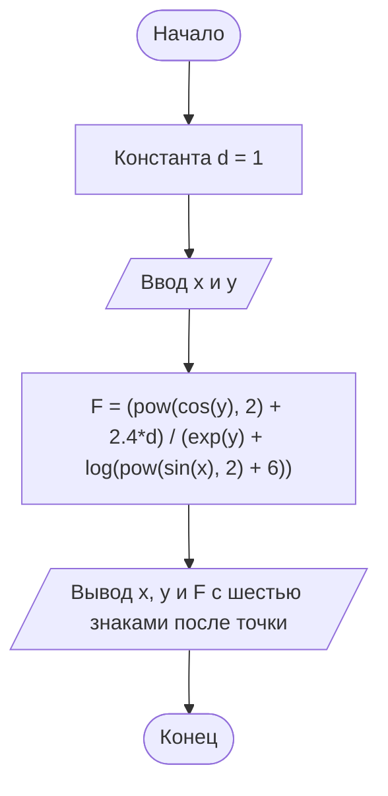

# ДЗ к лабораторной работе № 5

## Вариант 24

Вычислить функцию двух переменных:

$$
F(x,y)=\frac{\cos^2(y)+2.4d}{e^y+\ln(\sin^2(x)+6)},\qquad d=1.
$$

Пользователь вводит x и y. Углы задаются в радианах. Результат выводится с шестью знаками после точки.

## Файлы

- `dz lab5 .c` — исходный код на C.
- `README.md` — описание, контрольные примеры и блок-схема.

## Используемые функции

- `cos(y)` — косинус y.
- `sin(x)` — синус x.
- `pow(a, 2)` — квадрат числа a.
- `exp(y)` — экспонента, e в степени y.
- `log(a)` — натуральный логарифм a.

Функции объявлены в `math.h`. Формат `%g` используется для компактного вывода исходных данных, `%.6f` — для вывода результата с шестью знаками после точки.

## Сборка и запуск

```sh
gcc -std=c11 -Wall -Wextra -pedantic "dz lab5 .c" -o homework5 -lm
```

В Windows PowerShell:

```powershell
.\homework5.exe
```

В Linux или macOS: `./homework5`.

Исходный файл сохранён в UTF-8. Если русские буквы в консоли Windows отображаются неправильно, перед запуском выполните `chcp 65001`.

Программа рассчитана на ввод двух корректных вещественных чисел. Десятичный разделитель — точка. Запись `1.5e-6` означает 1.5 × 10⁻⁶.

## Контрольные примеры

| x | y | F(x, y) |
| --- | --- | --- |
| 4 | 2 | 0.277522 |
| 1.5e-6 | -2e9 | 1.430608 |

## Блок-схема



## Вывод

Реализовано вычисление функции двух переменных с использованием стандартных математических функций языка C. Результаты проверены на контрольных примерах.
